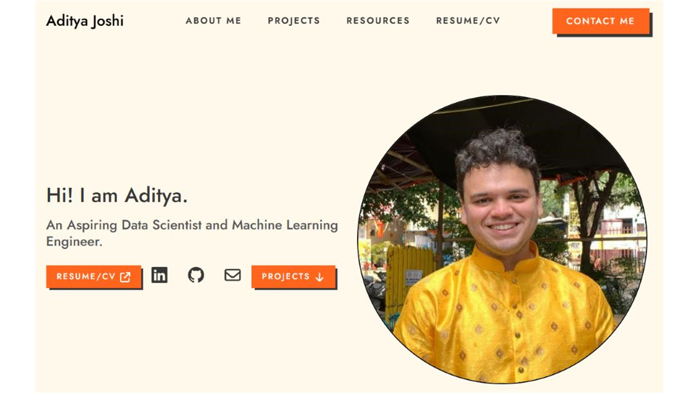

  

  <h1>Hi, I'm Aditya Joshi</h1>
  

    <strong>Data Scientist and PM at Revcloud</strong> working across ML systems,
    full-stack development, system design, and product execution.
  

  

    I like turning messy real-world data into tools people can actually use.
  

  

    &nbsp;&nbsp;&nbsp;&nbsp;&nbsp;
    &nbsp;&nbsp;&nbsp;&nbsp;&nbsp;
    &nbsp;&nbsp;&nbsp;&nbsp;&nbsp;
    
  

---

## 🚀 What I'm Building

I work on the Experiments Manager for [Alyson AI](https://alyson.ai) at Revcloud, where my role sits across system design, full-stack development, ML pipelines, model development, and forecasting. I also coordinate a small group of developers and ML engineers, so a lot of my day-to-day is about turning product goals into clear technical plans and shippable work.

Outside work, I head the tech team at [Forengers Foundation](https://www.forengers.in), a climate-action NGO in Pune. I maintain web systems, build internal automations, and shipped a digital certification platform where each issued credential gets its own unique URL.

---

## ✨ Featured Projects

<table>
  <tr>
    <td width="50%" valign="top">
      
      <h3>🏠 <a href="https://pune.adityajoshi.in">PuneHousing.in</a></h3>
      
<strong>ML app · Browser-side inference · Real estate data</strong>

      
Price prediction and similar-property recommendations for Pune housing, built from 30k+ scraped listings.

      

        
        
        
        
      

      

        <strong>Highlights:</strong> the price prediction and recommendation system both run fully in the browser using ONNX, with no backend API needed for ML inference.
      

      

        
        
      

    </td>
    <td width="50%" valign="top">
      
      <h3>🗳️ <a href="https://kea.adityajoshi.in">Karnataka Elections Analysis</a></h3>
      
<strong>Data analysis · OCR pipeline · Interactive storytelling</strong>

      
Interactive analysis of Karnataka Assembly elections across vote counts, margins, candidates, and electoral trends.

      

        
        
        
        
      

      

        <strong>Highlights:</strong> 57k+ PDFs, scraping, OCR, OpenAI Batch API,
        Plotly.js, Flourish Studio, AWS EC2, NGINX.
      

      

        
        
      

    </td>
  </tr>
  <tr>
    <td width="50%" valign="top">
      
      <h3>📈 <a href="https://walmart.adityajoshi.in">Walmart Sales Forecasting</a></h3>
      
<strong>Time series · Forecasting · Retail analytics</strong>

      
Analysis and forecasting project exploring weekly sales, holiday effects, store-level patterns, and future demand.

      

        
        
        
      

      

        <strong>Highlights:</strong> feature analysis, model comparison,
        notebook-to-site publishing, and practical business interpretation.
      

      

        
        
      

    </td>
    <td width="50%" valign="top">
      
      <h3>🌐 <a href="https://www.adityajoshi.in">Personal Website</a></h3>
      
<strong>Portfolio · Project writing · Public home base</strong>

      
A clean personal site collecting my projects, resume, resources, and ways to reach me.

      

        
        
        
      

      

        <strong>Highlights:</strong> project pages, resume links, contact paths,
        and a public surface for work I want people to find.
      

      

        
      

    </td>
  </tr>
</table>

  Project screenshot convention: <strong>1280 x 720 px</strong> images in <code>assets/</code>.

---

## 📚 Notes & Resources

I maintain a growing set of data science and machine learning notes: digital notes, handwritten material, notebooks, references, and the kind of “future me will thank present me” explanations that slowly turn into a resource library. The preview below is meant to represent the whole notes library.

<table>
  <tr>
    <td width="52%" valign="top">
      
    </td>
    <td width="48%" valign="top">
      <h3>🧠 Notes Library</h3>
      <table>
        <tr>
          <th align="left">Topic</th>
          <th align="left">Link</th>
        </tr>
        <tr>
          <td>Machine Learning</td>
          <td><a href="https://docs.google.com/document/d/1rMXRlFJ5mDAzik4ipsySVFBUsI54E0NXocDhOct3YNM/edit?usp=sharing">View notes</a></td>
        </tr>
        <tr>
          <td>Statistics</td>
          <td><a href="https://docs.google.com/document/d/1Q2zwoGjBX1Vpa7bEWAOyzZJTJDtmfT8I-YEgkSQCBsQ/edit?usp=sharing">View notes</a></td>
        </tr>
        <tr>
          <td>Databases and SQL</td>
          <td><a href="https://docs.google.com/document/d/1sZOzI4v6-H8X5PJZgeBQFqkwPOBCZhqDPH52HqKDCQI/edit?usp=sharing">View notes</a></td>
        </tr>
        <tr>
          <td>Python</td>
          <td><a href="https://docs.google.com/document/d/1z_m8OYimE4HswM4zOeZxDfJ-jmUXtI8WJpSGKUMU1QY/edit?usp=sharing">View notes</a></td>
        </tr>
        <tr>
          <td>Full notes repository</td>
          <td><a href="https://github.com/joshiaditya0511/data-science-notes">Open repo</a></td>
        </tr>
        <tr>
          <td>Resources page</td>
          <td><a href="https://www.adityajoshi.in/#resources">Open page</a></td>
        </tr>
      </table>
    </td>
  </tr>
</table>

  Notes preview convention: replace the placeholder with a <strong>1200 x 800 px</strong> GIF named <code>assets/notes-preview.gif</code>.

---

## 🧰 Tech I Reach For

<table>
  <tr>
    <td><strong>ML and Data</strong></td>
    <td>Python, Pandas, Scikit-learn, LightGBM, ONNX, Plotly.js, Selenium, OCR pipelines</td>
  </tr>
  <tr>
    <td><strong>Backend and Cloud</strong></td>
    <td>FastAPI, SQL, PostgreSQL, SQL Server, AWS SageMaker, Lambda, EC2, RDS, Docker, NGINX</td>
  </tr>
  <tr>
    <td><strong>Frontend and Product</strong></td>
    <td>JavaScript, React, Astro, Bootstrap, Tailwind CSS, dashboards, analytics UX</td>
  </tr>
  <tr>
    <td><strong>Tools and Workflow</strong></td>
    <td>Git, Vercel, Google Apps Script, Claude Code, Lovable.dev, good notes, stubborn debugging</td>
  </tr>
</table>

---

## 🌿 A Bit More Human

Before data science, I studied chemical engineering and spent a year on a BAJA SAE team designing ATV brake components with SolidWorks, Ansys, and plenty of hands-on manufacturing chaos. That experience shaped how I think about constraints, teamwork, practical design, and solving problems with whatever information is actually available.

Away from the laptop, I play badminton, take mildly excessive notes, and make enthusiastic attempts at wooden staff spinning and pretend sword-fighting. Some hobbies should probably stay hobbies. The notes, thankfully, became [public DS/ML resources](https://www.adityajoshi.in/#resources).

---

  

    <a href="https://www.adityajoshi.in">Portfolio</a> &nbsp;·&nbsp;
    <a href="https://www.linkedin.com/in/joshiaditya0511">LinkedIn</a> &nbsp;·&nbsp;
    <a href="mailto:contact@adityajoshi.in">Email</a>
  

  
<em>Always happy to talk data, ML systems, useful products, or strangely detailed notes.</em>

