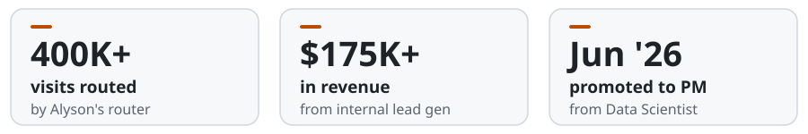
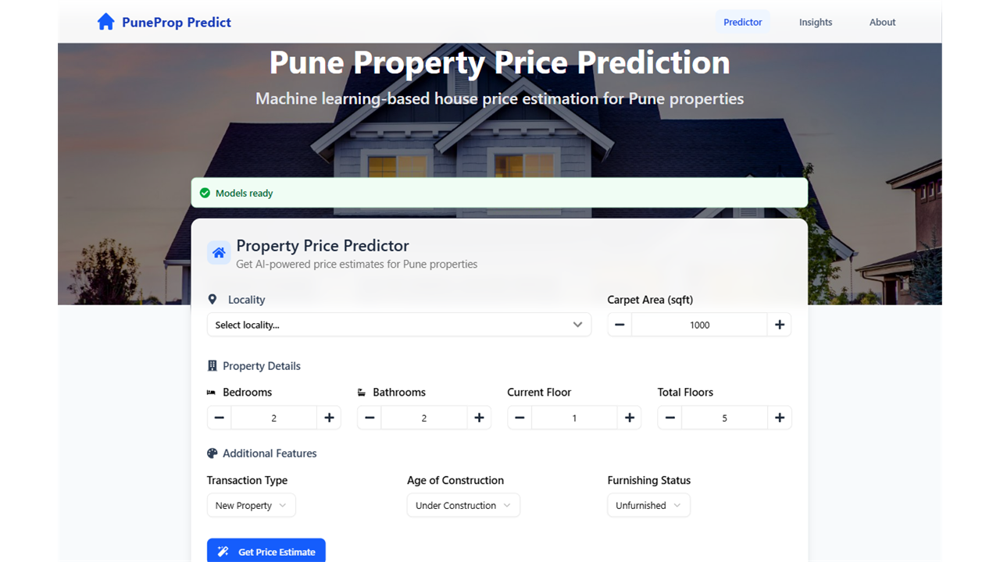
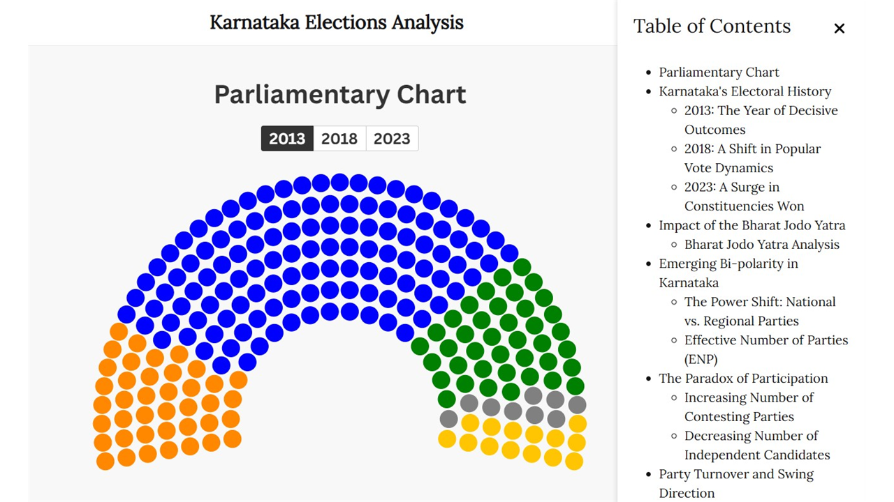
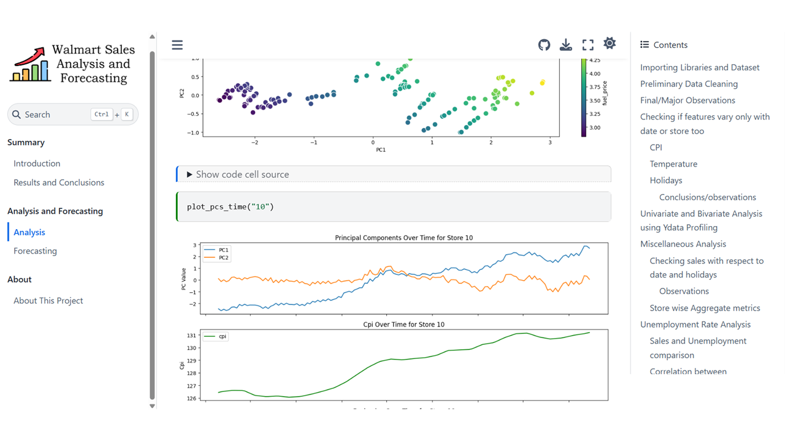
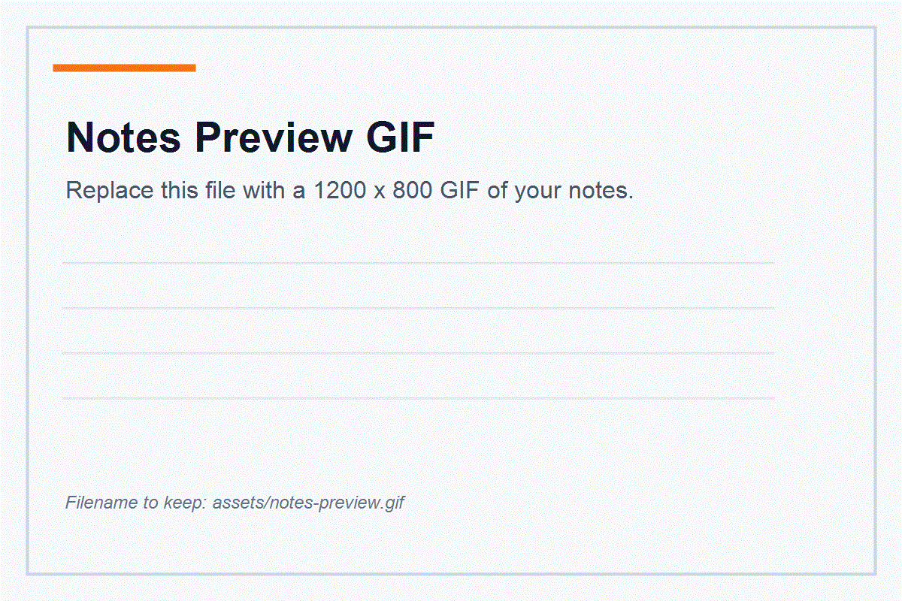

<picture>
  <source media="(prefers-color-scheme: dark)" srcset="assets/banner-dark.svg">
  <source media="(prefers-color-scheme: light)" srcset="assets/banner-light.svg">
  
</picture>

  
  
  
  

## Right now: Alyson AI

I'm a product manager at **Revcloud**, though "AI builder" is probably the more honest label. I own the product for [**Alyson AI**](https://alyson.ai), an AI marketing SaaS that tests different versions of landing pages, traffic routing and campaigns on live traffic, and shows which one earns more.

I joined as a data scientist and built the pieces at the center of it: the **traffic router** that sends each visitor to a page by model prediction, audience segment or fixed split, and the **revenue-per-click and conversion-rate models** that predict what each click should be worth. Pages are judged on how far they beat that prediction, so a page that just got luckier traffic doesn't win by accident. In June 2026 I was promoted to product manager.

<picture>
  <source media="(prefers-color-scheme: dark)" srcset="assets/alyson-stats-dark.svg">
  <source media="(prefers-color-scheme: light)" srcset="assets/alyson-stats-light.svg">
  
</picture>

These days that looks like:

- **Specs and delivery.** Writing the product specs and delivery plans, and leading engineers, data scientists, data engineers and a designer from definition to release.
- **Architecture calls.** I designed how Alyson's AI landing page builder deploys pages to customers' own domains, and I review system design across the platform.
- **Still building.** The analytics and reporting layer is mine, hands-on: how far each page beat its prediction, how confident we can be in that, and how traffic was split. I also build SMS campaign audiences end to end.

## Featured projects

All three are open source and live.

### 🏠 Pune Housing Price Prediction

`Machine Learning` `Recommendation Systems` `Web Scraping`

A zero-backend web app that predicts house prices in Pune and recommends similar properties, based on what you're looking for.

- Typical prediction lands within **~11% of the actual price** (median APE, R² ≈ 0.93), using LightGBM trained on **30k+ listings** scraped with Selenium.
- Both the price model and the recommender run **in the browser as ONNX models**, so the live site needs no ML backend.
- Also shipped a second architecture: a containerized FastAPI backend on AWS EC2 behind Nginx.

**Stack:** Python · Pandas · Scikit-learn · LightGBM · ONNX · FastAPI · Docker · Astro · React · Vercel

**[Live site](https://www.punehousing.in)** · **[Code](https://github.com/joshiaditya0511/pune-house-price-prediction)**

### 🗳️ Karnataka Elections Data Analysis

`Data Analysis` `Web Scraping` `OCR`

An interactive look at the Karnataka Assembly elections: vote counts, candidate details, vote margins, the Bharat Jodo Yatra's effect, and more.

- Built a pipeline that scraped and processed **57k+ PDFs** (Requests, BeautifulSoup, Selenium, PyPDF2, Tesseract OCR).
- Categorized the extracted data with **OpenAI's Batch API** (GPT-4o-mini) at half the real-time cost.
- Published interactive Plotly.js and Flourish charts on a site hosted on AWS EC2 with NGINX.

**Stack:** Python · Pandas · Selenium · Tesseract · OpenAI Batch API · Plotly.js · AWS EC2 · NGINX

**[Live site](https://kea.adityajoshi.in)** · **[Code](https://github.com/joshiaditya0511/karnataka-election-analysis)**

### 📈 Walmart Sales Analysis and Forecasting

`Time Series` `Data Analysis` `Forecasting`

Time series analysis and forecasting of Walmart's weekly store sales, to uncover patterns, quantify holiday effects and predict future trends.

- Exploratory analysis of trends, seasonal patterns, holiday effects and anomalies in store-level sales.
- Forecasts future weekly sales with statistical and machine learning models, published as a readable notebook site.

**Stack:** Python · Pandas · Jupyter · Kaggle Walmart dataset

**[Live site](https://walmart.adityajoshi.in)** · **[Code](https://github.com/joshiaditya0511/walmart-sales-forecasting)**

## Notes and resources

Free resources like Khan Academy, NPTEL and MIT OpenCourseWare made a big difference to how I learned, so I share my own notes the same way. I'm a compulsive note taker, and over time they've turned into a library: digital and handwritten notes, Jupyter notebooks, and references to the best external material I found.

| [Machine Learning](https://docs.google.com/document/d/1rMXRlFJ5mDAzik4ipsySVFBUsI54E0NXocDhOct3YNM/edit?usp=sharing) | [Statistics](https://docs.google.com/document/d/1Q2zwoGjBX1Vpa7bEWAOyzZJTJDtmfT8I-YEgkSQCBsQ/edit?usp=sharing) | [Databases & SQL](https://docs.google.com/document/d/1sZOzI4v6-H8X5PJZgeBQFqkwPOBCZhqDPH52HqKDCQI/edit?usp=sharing) | [Python](https://docs.google.com/document/d/1z_m8OYimE4HswM4zOeZxDfJ-jmUXtI8WJpSGKUMU1QY/edit?usp=sharing) |
| :---: | :---: | :---: | :---: |

The full collection, notebooks included, lives in the **[data-science-notes](https://github.com/joshiaditya0511/data-science-notes)** repo.

## How I got here

| When | Role | Where |
| --- | --- | --- |
| Jun 2026 – now | **Product Manager** | Revcloud |
| Aug 2025 – Jun 2026 | **Data Scientist** | Revcloud |
| Aug 2024 – Jul 2025 | **Exec. PG Certification, Data Science & AI** | IIT Roorkee |
| Mar 2024 – Aug 2026 | **Technical Head** (volunteer) | Forengers Foundation, a climate-action NGO in Pune |
| Oct 2023 – Jun 2024 | **Software Engineering Intern** | Oriole Labs |
| 2019 – 2020 | **Brakes design**, BAJA SAE India | Team Kraftwagen |
| 2018 – 2022 | **B.E. Chemical Engineering** | Sinhgad College of Engineering, Pune |

Yes, chemical engineering. In undergrad I designed brake calipers, discs and mounts for an ATV we built from scratch for a national competition. Exhausting, slightly unhinged, and still the best hands-on learning I've had.

## Toolbox

**Product:** `Specs & PRDs` `Roadmapping` `System design` `Cross-functional delivery`

**Data science:** `Python` `Pandas` `Scikit-learn` `LightGBM` `ONNX` `A/B testing` `Statistical inference`

**Data & backend:** `SQL` `Postgres` `SQL Server` `FastAPI` `Docker` `Nginx` `Selenium`

**Cloud:** `AWS SageMaker` `Lambda` `EC2` `RDS` `EventBridge` `Vercel`

**Frontend:** `JavaScript` `React` `Astro` `Plotly.js`

**Workflow:** `Git` `Claude Code`

## Off the clock

Badminton, mostly. Also some mildly embarrassing attempts at wooden staff spinning and (pretend) sword-fighting. Don't ask.

---

  <a href="https://www.adityajoshi.in">adityajoshi.in</a> ·
  <a href="https://www.linkedin.com/in/joshiaditya0511">LinkedIn</a> ·
  <a href="mailto:contact@adityajoshi.in">contact@adityajoshi.in</a>
   
  Always happy to talk experiments, ML systems, useful products, or strangely detailed notes.

